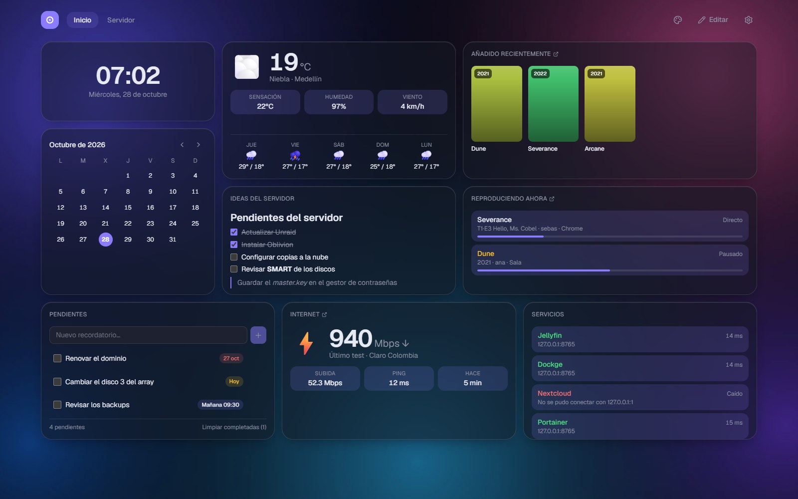
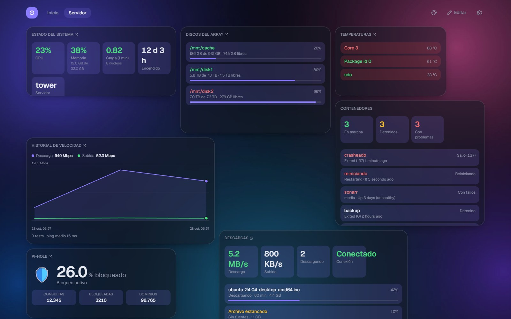
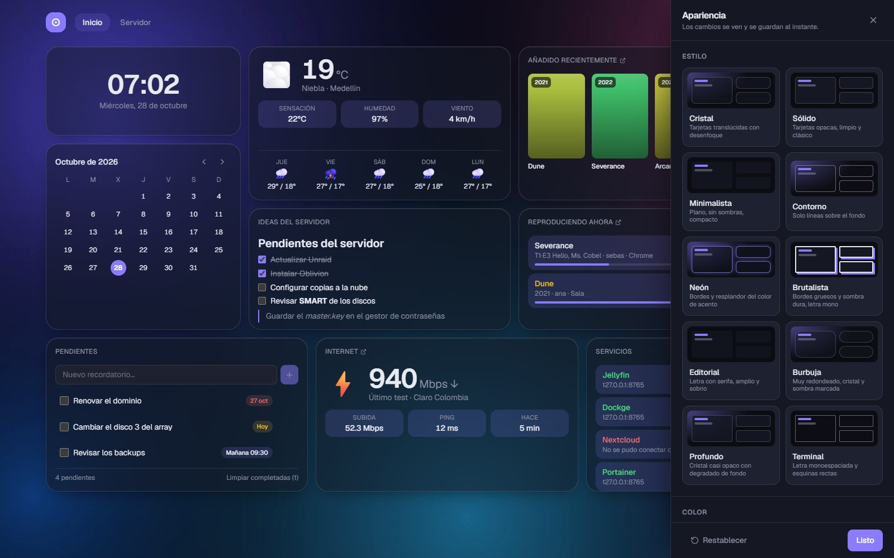
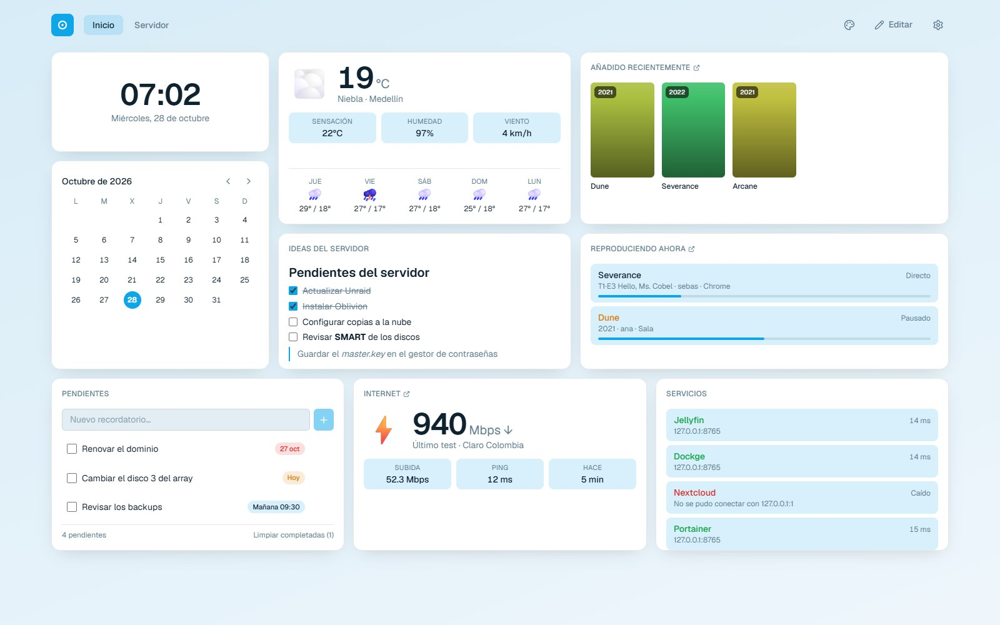
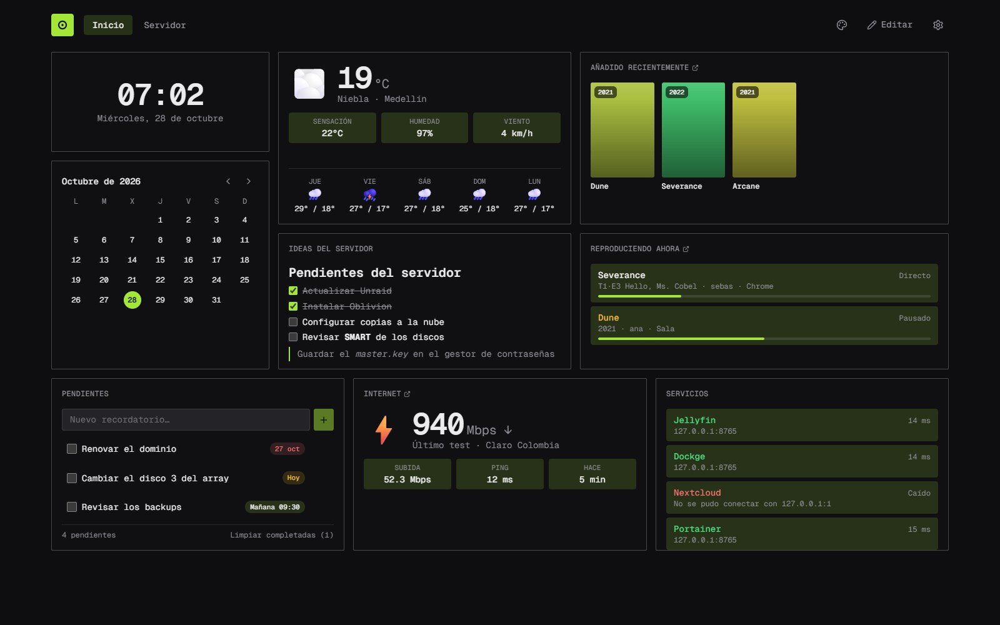
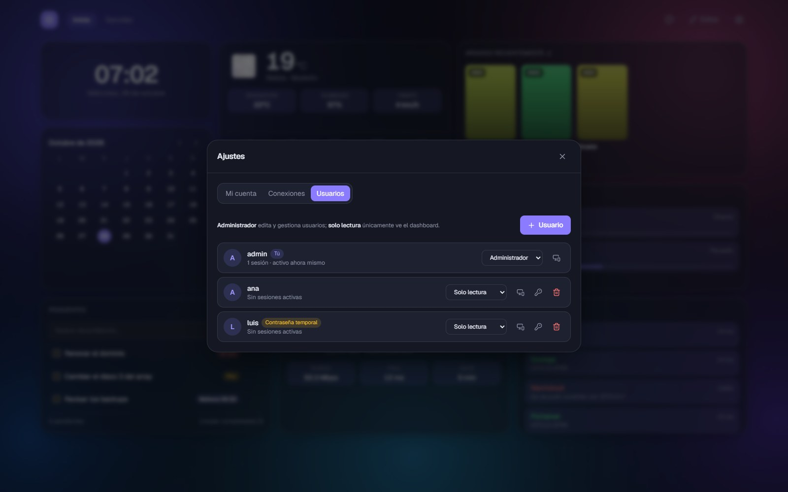

<p align="center">
  
</p>

<p align="center">
  <b>Un dashboard para tu homelab: seguro, bonito y tuyo.</b><br>
  Editor visual sin YAML, personalización total y plugins sencillos.
</p>

<p align="center">
  <a href="https://github.com/sebastianvelezg/OBLIVION/actions/workflows/ci.yml"></a>
  <a href="LICENSE"></a>
  <a href="https://github.com/sebastianvelezg/OBLIVION/releases"></a>
  <a href="https://github.com/sebastianvelezg/OBLIVION/pkgs/container/oblivion"></a>
</p>

<p align="center">
  
</p>

> **English:** Oblivion is a self-hosted, security-focused dashboard for your homelab. Visual drag-and-drop editor (no YAML), deep theming (glass, solid, outline, wallpapers…), built-in notes/reminders/links, and a tiny plugin system (Jellyfin, Jellyseerr, qBittorrent, Transmission, Glances, Docker, Pi-hole, AdGuard Home, Uptime Kuma, Speedtest Tracker, service status and weather included). The interface and documentation are in Spanish for now; translations are welcome.

> **Estado: versión alfa (0.x).** Funciona y está probado, pero todavía es joven: haz copia de seguridad antes de actualizar y abre un *issue* si algo no te cuadra.

## ¿Por qué Oblivion?

Los dashboards de homelab suelen pedirte editar archivos de configuración y se ven todos iguales. Oblivion parte de otra idea: **todo se hace con el ratón, se ve como tú quieras y la seguridad es lo primero**, porque guarda las claves de tus servicios.

## Características

**Editor visual**
- Arrastra, redimensiona, configura y borra widgets; varias páginas; todo se guarda en el servidor. Nada de YAML.
- Se adapta al móvil.

**Personalización a fondo** (botón 🎨, con vista en vivo)
- 10 estilos listos: **Cristal**, **Sólido**, **Minimalista**, **Contorno**, **Neón**, **Brutalista**, **Editorial**, **Burbuja**, **Profundo** y **Terminal**.
- 6 paletas, modo oscuro/claro/automático y color de acento libre.
- Tarjetas con opacidad, desenfoque, redondeo y sombra ajustables.
- Fondo: aurora, liso, degradado o **tu propia foto** (con desenfoque y oscurecimiento), y **uno distinto por página**.
- Retoques **por widget**: color de acento y opacidad propios (p. ej. rojo para alertas), título visible u oculto y enlace.
- 3 densidades y 3 tipografías.

**Widgets de uso diario**
- **Notas** en Markdown con tareas que se marcan con un clic.
- **Recordatorios** con fecha y hora; avisan cuando llega la hora.
- **Enlaces**, **Reloj**, **Calendario**, **Calculadora**, **Buscador**, **Saludo** y **Página web** embebida.

**Integraciones** (plugins)
- **Conexiones compartidas**: escribes la URL y la clave de cada servicio una sola vez, con botón **Probar conexión**.
- **Jellyfin**: quién está viendo qué, biblioteca y carátulas; incluso todo en un solo panel.
- **Jellyseerr**, **qBittorrent** y **Transmission**: solicitudes y descargas.
- **Glances**: CPU, memoria, discos y temperaturas de tu servidor (pensado para Unraid).
- **Docker** (solo lectura, vía proxy), **Pi-hole**, **AdGuard Home** y **Uptime Kuma**.
- **Scrutiny** (salud SMART de los discos), **UPS** (PeaNUT), **Immich**, **Jellystat**, **Tailscale** y **Gluetun** (VPN).
- **Sonarr**, **Radarr**, **Lidarr**, **Prowlarr** y **Bazarr**: colas, estrenos y lo que falta.
- **Home Assistant**, **Nextcloud**, **Paperless-ngx** y **Nginx Proxy Manager** (hosts y caducidad de certificados).
- **What's Up Docker** y **Watchtower** (actualizaciones), **Gatus**, **Healthchecks**, **Netdata** y **Beszel**.
- **Copias de seguridad:** **Duplicati**, **Kopia** y **Backrest**: cuándo fue la última y si falló.
- **Syncthing**, **Audiobookshelf**, **Navidrome**, **Kavita**, **Komga**, **Mealie**, **Karakeep** y **Linkwarden**.
- **SABnzbd**, **NZBGet** y **Deluge** (descargas), **Traefik**, **Caddy** y **Cloudflare Tunnel**, y **Gotify** y **ntfy** (notificaciones).
- **Titulares RSS** con enlace a cada artículo y **API personalizada**: conecta cualquier API JSON sin programar.
- **Speedtest Tracker**: velocidad actual e historial en gráfica (API antigua y nueva).
- **Estado de servicios**: semáforo con latencia para cualquier URL (Dockge, Portainer, tu NAS…).
- **Clima** (Open-Meteo, sin API key).
- ¿Falta algo? [Crear un plugin](docs/plugins.md) es una carpeta con un archivo, sin compilar.

**Seguridad desde el diseño**
- Login propio, contraseñas con scrypt, sesiones `HttpOnly`, protección CSRF y límite de intentos.
- Usuarios con roles (administrador / solo lectura), contraseñas temporales y cierre de sesiones remoto.
- Las API keys se guardan **cifradas** y nunca llegan al navegador.
- Los plugins solo pueden llamar a las URLs que tú configures (protección anti-SSRF).
- Contenedor sin root, de solo lectura y sin capacidades de Linux.
- Detalle y límites en [docs/security.md](docs/security.md).

## Instalación rápida (Docker)

```bash
mkdir oblivion && cd oblivion
curl -fsSLO https://raw.githubusercontent.com/sebastianvelezg/OBLIVION/main/docker-compose.yml
curl -fsSL https://raw.githubusercontent.com/sebastianvelezg/OBLIVION/main/.env.example -o .env
```

Edita `.env` y define `OBLIVION_SETUP_TOKEN` con un valor largo y aleatorio (por ejemplo `openssl rand -hex 16`). Después:

```bash
docker compose up -d
```

Abre `http://IP-DEL-SERVIDOR:3000`, crea la cuenta de administrador (te pedirá ese código) y empieza a añadir widgets.

> Guía completa —proxy inverso con HTTPS, actualizar, copias de seguridad, instalación sin Docker y solución de problemas— en **[docs/installation.md](docs/installation.md)**.

## Capturas

<table>
  <tr>
    <td width="50%"><br><sub><b>Servidor</b>: discos, Docker, descargas, DNS y gráfica de velocidad</sub></td>
    <td width="50%"><br><sub><b>Apariencia</b> con vista en vivo</sub></td>
  </tr>
  <tr>
    <td width="50%"><br><sub><b>Sólido</b> en modo claro</sub></td>
    <td width="50%"><br><sub><b>Terminal</b>: monoespaciado y esquinas rectas</sub></td>
  </tr>
  <tr>
    <td width="50%"><br><sub><b>Usuarios</b>, roles y sesiones</sub></td>
    <td width="50%"></td>
  </tr>
</table>


> Las capturas usan servidores de demostración simulados.

## Documentación

| | |
|---|---|
| [Instalación](docs/installation.md) | Docker, HTTPS, actualizaciones, copias de seguridad, problemas frecuentes |
| [Configuración](docs/configuration.md) | Variables de entorno, widgets, apariencia, usuarios |
| [Integraciones](docs/integrations.md) | Conectar Jellyfin, Sonarr/Radarr, Glances, Docker, UPS, copias de seguridad y más de 50 servicios |
| [Plugins](docs/plugins.md) | Crear tus propios widgets |
| [Seguridad](docs/security.md) | Cómo se protege y qué no cubre |
| [Desarrollo](docs/development.md) | Arquitectura, compilar y probar |

## Contribuir

¡Toda ayuda es bienvenida! Lee la [guía de contribución](CONTRIBUTING.md). Si encuentras una vulnerabilidad, **no abras un issue público**: sigue la [política de seguridad](SECURITY.md).

## Licencia

Oblivion es software libre bajo la licencia **GNU GPL v3 o posterior**. Consulta el archivo [LICENSE](LICENSE).
